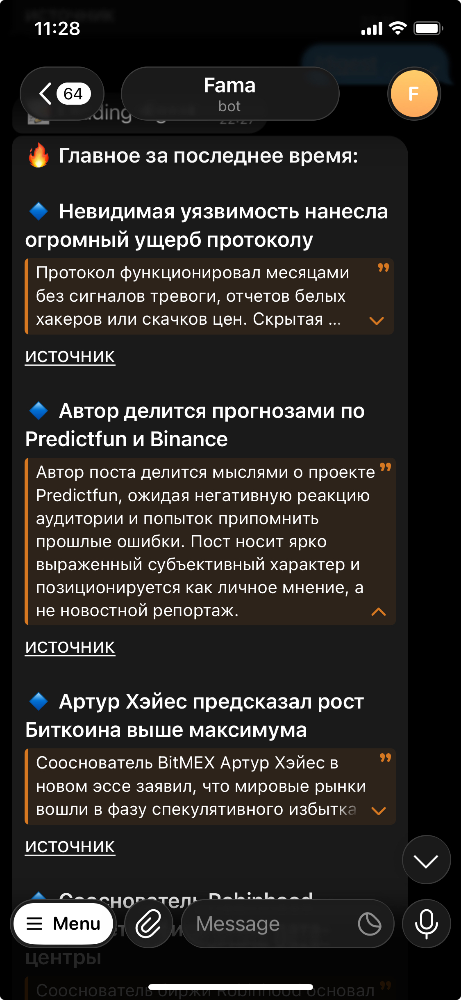

# 📡 News Radar

**A multi-source AI radar that ranks by practical value, not by volume.**

Pulls AI articles from RSS, Hacker News and dev.to, scores every item for practical value with an LLM, fills a daily digest by quota, writes a condensed review of each selected article, and publishes the issue to the [Neuronavt](https://neuronavt.blog) blog with an announcement in a Telegram channel. The same engine also runs a crypto profile over Telegram channels, with semantic dedup and trend clustering. Everything runs in Docker, on a local GPU or on hosted LLM providers.


---

<p align="center">
  
</p>

<p align="center"><sub>A digest in Telegram from the crypto profile (<code>spoiler</code> template), the domain the engine was first proven on.<br>The AI-articles digest now lives on <a href="https://neuronavt.blog">neuronavt.blog</a>, with a short announcement in the channel.</sub></p>

## The problem

A feed optimizes for loud. Twelve sources break the same story within minutes, an announcement with no details outranks a write-up with a measurable result, and the one post that would actually change how you work tomorrow scrolls past at 3am.

News Radar inverts the ranking. Each item is scored for **practical applicability**: can someone who already uses AI tools do something differently after reading this? Only the top of that ranking reaches the digest, and hype gets at most one slot.

The engine started in production on 57+ Telegram channels in the crypto domain, which is where dedup economics, trend clustering and the digest queue were proven on 100–200 messages a day. It was then re-pointed at AI content: same core, new collectors, new scoring profile, a website as the main outlet. Every step shipped behind feature flags, so the production path never broke.

## Pipeline (AI articles)

```
     RSS / Atom            Hacker News              dev.to API
     5 AI feeds            Algolia, points ≥ 30     tag ai, reactions ≥ 10
          │                       │                       │
          └───────────────────────┼───────────────────────┘
                                  ▼
                    ┌─────────────────────────────┐
                    │  NORMALIZE   RawMessage      │  URL normalization + dedup,
                    │  source-agnostic core        │  age window, full-text fetch
                    └──────────────┬──────────────┘
                                   ▼
                    ┌─────────────────────────────┐
                    │  VALUE SCORING  (ai_value)   │  content_type, value_score,
                    │  strict JSON, golden-set     │  takeaway, topic, is_ad
                    │  evals gate every prompt     │
                    └──────────────┬──────────────┘
                                   ▼
                    ┌─────────────────────────────┐
                    │  FUNNEL  quotas + carry-over │  cases/tutorials first,
                    │  daily slot, 09:10 MSK       │  unpicked items wait ≤ 7 days
                    └──────────────┬──────────────┘
                                   ▼
          ┌────────────────────────┼────────────────────────┐
          ▼                        ▼                        ▼
   digest post + one         stored in SQLite,        Telegram channel:
   review per article  ──►   committed to the blog ─► announcement; admin gets
   (LLM, from full text)     repo, deploy awaited     stats and failure alerts
```

The crypto profile runs the original path: Telegram userbot → cheap filters → LLM analysis → BGE-m3 dedup in ChromaDB → HDBSCAN trends → alerts and digests to Telegram.

## Status

The project runs against a written spec with numbered iterations. This table reflects the real state of the tree, not a wish list. Full detail is in [`specs/STATE.md`](specs/STATE.md).

| Capability | Status |
|---|---|
| RSS, Hacker News and dev.to collectors: poll mode, URL normalization, age window, fair full-text budget | ✅ in production |
| `ai_value` scoring: `content_type`, `value_score`, `takeaway`, Russian summaries (prompt `ai_value-v3.1`) | ✅ in production, gated on the golden set |
| Quota funnel with 7-day carry-over and a candidates list for items that didn't make the cut | ✅ in production |
| Categories and named digests: independent schedules, sources and templates per digest | ✅ in production |
| Per-article reviews: a condensed Markdown write-up from the full text | ✅ in production |
| Publishing to Neuronavt: digest post + `/reviews` collection, site-first, recovery command | ✅ in production |
| Telegram channel announcement; admin-only stats and alerts when the site publish or deploy fails | ✅ in production |
| VPS deployment of the articles stack, auto-deploy on push to `main` | ✅ in production |
| `llm_core`: provider registry, model per task, OpenAI and Anthropic protocols, strict JSON, usage accounting | ✅ shipped, `mypy --strict` |
| Crypto profile: Telegram userbot, semantic dedup, HDBSCAN trends, breaking alerts, `classic`/`spoiler` digests | ✅ built and proven, currently switched off |
| FastAPI service: feed, search, topics, trends, digests, stats | ✅ |
| GitHub and Reddit collectors, source weights, threshold calibration | ⬜ next iteration |
| Questions to the knowledge base in the bot; deep review for the top articles | ⬜ backlog |
| Discord, X/Twitter, on-chain data | ⬜ backlog |

## Engineering notes

**Value, measured.** 34 real items from a live collector run were hand-labelled into a dated golden set (`tests/golden/`). Every prompt version and every candidate model has to clear thresholds against it, most importantly *hype never scores ≥ 8*. Model choice per task is decided by measurement: the classifier and reviews run on a model roughly 20× cheaper than the digest writer, after it matched quality on the same set.

**Quotas, not a top-N.** The digest is filled by content type: cases and tutorials make up the body, tool releases and research get a couple of slots, hype gets at most one. Items that score well but miss the day's quota carry over for up to 7 days instead of being lost.

**Site first, Telegram announces.** An issue is a blog post plus one review page per article. Both are stored in SQLite before anything is published, then committed to the blog repo. The bot waits until the page actually opens before it posts the channel announcement. If the commit or the deploy fails, readers get nothing and the admin gets an alert. `/digest <name> site` republishes from the database without regenerating anything.

**Categories and named digests.** A category binds sources to an analyzer profile, a selection mode and a template. A digest is a named schedule over categories. Articles and crypto run side by side, each with its own slots, as separate messages.

**Paying once for a story twelve sources break.** In the crypto profile, BGE-m3 embeddings in ChromaDB catch reposts before the expensive call: above 0.90 cosine similarity the existing analysis is cloned. Together with length and ad heuristics, roughly half of all input never reaches the model.

**Trends, not a firehose.** HDBSCAN clusters the recent window every 15 minutes. A composite TrendScore ranks clusters by unique sources × average importance × recency × reach. Five independent channels saying the same thing is signal; one channel saying it five times is not.

**Age window before spend.** Feeds like OpenAI's return years of archive on the first poll. Anything older than `sources.max_age_hours` is dropped before the full-text fetch and before the database write. URLs are normalized (`utm_*`, `fbclid`, fragments, trailing slash), so the same article arriving via RSS and Hacker News is one row.

**Untrusted input is treated as untrusted.** Article bodies and README text are third-party data that can contain instructions. Content is fenced in the prompt and marked as data only, and the model answers through a strict JSON schema rather than free text.

**Provider-agnostic LLM layer.** `llm_core/` is a self-contained package held to `mypy --strict`: provider registry and catalog of profiles (`config/providers.json`), routing by task (`classify`, `digest`, `knowledge`), both OpenAI-style and Anthropic-style protocols, retries, usage and cost accounting, secret masking, response validation. Switching from a local Qwen to a hosted model is a change in `.env`, not in code.

**Small server, lazy imports.** The articles stack runs on a 2 CPU / 1.9 GB VPS in a ~230 MB image without torch, ChromaDB or HDBSCAN. Those are imported lazily and only the crypto hooks need them.

**SQLite in WAL mode** lets ingest write while the API reads, without the lock contention that usually pushes a project this size onto Postgres too early.

## The value model

```json
{
  "content_type": "practical_case | tutorial | tool_release | research | opinion | hype_news",
  "value_score": 1-10,
  "has_outcome": true,
  "takeaway": "one line: who applied what, and what came out of it",
  "topic": "agents | llm_ops | integrations | models | infra | crypto | other"
}
```

The ranking priority is applicability for someone using existing AI tools. A paper with impressive numbers about training your own model scores lower than a write-up on integrating a tool that already exists. The golden set carries an explicit expiry note: when the owner's focus shifts, the set is re-labelled rather than the classifier being tuned to match old labels.

## Stack

Python 3.11 · FastAPI · python-telegram-bot · Telethon · feedparser · trafilatura · OpenAI / Anthropic / OpenRouter or a local Qwen (vLLM / llama.cpp) · BGE-m3 · ChromaDB · HDBSCAN · SQLite (WAL) · Astro (blog) · Docker Compose · GitHub Actions · pytest · mypy

## Quick start

Everything runs in Docker; nothing is installed on the host.

```bash
cp .env.example .env                        # LLM keys, Telegram bot, GitHub tokens
docker compose --profile feeds up -d        # chromadb, collectors, analyzer, api, bot
```

| Variable | Where to get it | Required |
|---|---|:--:|
| `TELEGRAM_BOT_TOKEN` | @BotFather | ✅ |
| `TELEGRAM_ALLOWED_USERS` / `TELEGRAM_ADMIN_USERS` | @userinfobot | ✅ |
| `LLM_PROVIDERS` + `LLM_KEY_<PROVIDER>` | provider dashboard; profile names in `config/providers.json` | ✅ |
| `NEURONAVT_GITHUB_TOKEN` | GitHub fine-grained token with write access to the blog repo | for site publishing |
| `TELEGRAM_API_ID` / `TELEGRAM_API_HASH` | https://my.telegram.org/apps | crypto profile only |

The crypto collector is a Telegram **userbot**, so it needs a one-time interactive login:

```bash
docker compose run --rm collector
```

Health check:

```bash
curl http://localhost:8100/health
```

Tests and type checks run inside the container:

```bash
docker compose run --rm --no-deps analyzer python -m pytest -q --ignore=tests/collector
```

```bash
docker compose run --rm --no-deps analyzer python -m mypy
```

Server deployment of the articles-only stack is described in [`docs/13_deploy_vps.md`](docs/13_deploy_vps.md).

## Configuration

All tuning lives in `config/settings.json` and applies within ~3 seconds, no restart. A trimmed example:

```json
{
  "categories": {
    "articles": { "sources": ["rss", "hackernews", "devto"], "analyzer": "ai_value",
                  "select": "quotas", "template": "ai_value", "extras": ["candidates", "knowledge", "site"] }
  },
  "digests": [
    { "name": "articles", "categories": ["articles"], "at": ["09:10"], "tz": "Europe/Moscow" }
  ],
  "channels": [{ "chat_id": -1003973615006, "digests": ["articles"] }],
  "site": { "enabled": true, "base_url": "https://neuronavt.blog", "wait_for_page_sec": 300 },
  "digest_templates": {
    "ai_value": { "quotas": { "practical": 4, "tools_research": 2, "hype": 0 },
                  "min_value_score": 7, "carryover_days": 7, "telegram": "announce" }
  },
  "llm_strict_json_tasks": ["knowledge", "digest", "classify"]
}
```

Secrets never go here; they live in `.env` only.

## Telegram bot

| Command | What it does |
|---|---|
| `/digest [name]` | latest digest |
| `/digest new [name] [hours] [force]` | generate a fresh digest now |
| `/digest <name> site` | admins: check the issue page, republish from the database if needed, then announce |
| `/stats` | admins: digest statistics |
| `/hot` · `/track` · `/untrack` · `/my_tracks` | crypto profile: trends and topic subscriptions |
| `/status` | pipeline statistics |

## Project layout

```
news-radar/
├── collectors/       rss · hackernews · devto · telegram · fulltext_fetcher · poll_runner
├── llm_core/         portable LLM layer: catalog · router · providers · transport · usage · validator
├── analyzer/         pipeline · value_classifier · value_funnel · renderer · knowledge_publisher
│                     site_digest · site_store · trend_tracker · embedder · chroma_client
├── api/              FastAPI service (:8100)
├── bot/              Telegram bot, digest schedule, site wait
├── database/         SQLite schema + migrations
├── config/           settings.json · providers.json · topics.json · hot-reload watcher
├── deploy/           lightweight image for the VPS
├── scripts/          one-off tools: legacy review migration, rescoring
├── specs/            spec, iteration state, acceptance reports
├── docs/             architecture documents and lessons learned
└── tests/            300+ tests, golden set and evals for the classifier
```

## How this is built

The project is developed spec-first, with LLMs as architect and implementers and the owner accepting the work:

- **One spec, versioned.** Every change to `specs/tz4-ai-value.md` is a changelog line and its own commit. The spec is the contract; the chat is not.
- **Small iterations.** Each one ships behind feature flags whose defaults preserve production behaviour and closes only when its acceptance criteria are green. Rejections are recorded: iteration 2 was sent back once and closed as 2.1.
- **Typed from day one.** New modules pass `mypy --strict`; legacy code is tightened only where it's touched.
- **Tests track behaviour, not coverage.** Tests are written for acceptance criteria and for bugs actually found. Weakening an existing test to make new code pass is not allowed.
- **Eval-driven for anything the model decides.** The golden set gates prompts and models before they rank anything real.
- **Docker-only.** Every run, test and migration happens inside a container; the host stays clean.

`docs/11_problems_learned.md` collects the traps found along the way, such as the config watcher that silently ignores keys missing from `DEFAULT_CONFIG`, archive-dumping feeds, a sleeping Mac that skipped the daily digest, and the blog theme that reset scroll position on "back".

## Roadmap

- ⬜ GitHub and Reddit collectors, source weights, threshold calibration
- ⬜ Questions to the knowledge base in the bot (read-only tools, budget limits)
- ⬜ Deep review for the top articles of an issue: check links, repos and claims
- ⬜ Blog: favourites, collections and likes
- ⬜ Discord · X/Twitter · on-chain data

## License

Source-available, all rights reserved; see [`LICENSE`](LICENSE). The code is public so it can be read and reviewed; it is not licensed for use or redistribution while the project is still in active development. An open source licence is on the table once it settles. For anything beyond reading, ask.
